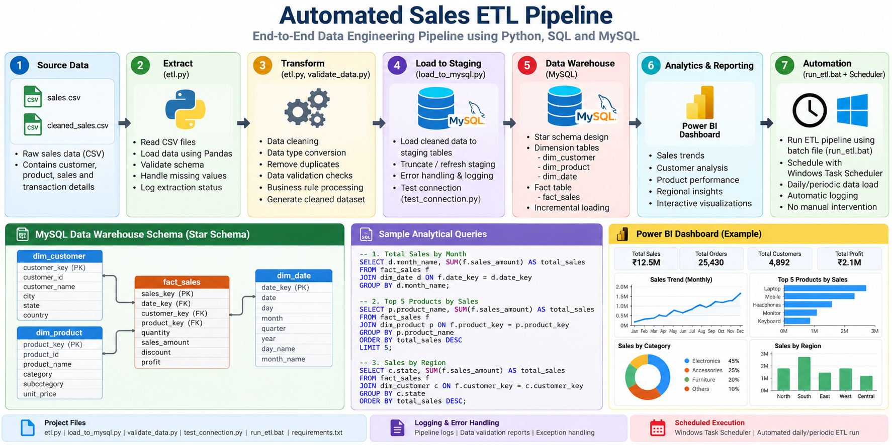

# Automated Sales ETL Pipeline Using Python and MySQL

## Project Overview

This project implements an automated Extract, Transform, Load (ETL) pipeline using Python, Pandas, and MySQL.

The pipeline processes Superstore sales data from CSV files, performs data cleaning and validation, and loads the transformed records into a structured MySQL data warehouse.

It follows a dimensional data modelling approach using fact and dimension tables. The solution also implements incremental loading, database indexing, execution logging, data validation, and automated scheduling through Windows Task Scheduler.

## Project Objectives

* Automate the extraction and transformation of sales data.
* Clean and validate raw CSV records.
* Design and implement a structured MySQL data warehouse.
* Apply dimensional data modelling.
* Prevent duplicate records through incremental loading.
* Improve analytical query performance using database indexes.
* Implement logging and error handling.
* Schedule automatic daily pipeline execution.

## Technologies Used

| Technology             | Purpose                                  |
| ---------------------- | ---------------------------------------- |
| Python                 | ETL development and automation           |
| Pandas                 | Data cleaning and transformation         |
| MySQL                  | Data warehouse                           |
| SQL                    | Data modelling, validation, and analysis |
| SQLAlchemy             | Database connectivity                    |
| MySQL Workbench        | Database management and query execution  |
| Python Logging         | Pipeline execution monitoring            |
| Windows Task Scheduler | Automated pipeline execution             |
| Git and GitHub         | Version control and project management   |

## Project Architecture

```text
             CSV Source Data
                    |
                    v
             Python ETL Pipeline
                    |
                    v
          Data Cleaning and Transformation
                    |
                    v
               Staging Table
                    |
                    v
          Dimension Mapping and Validation
                    |
                    v
              Incremental Loading
                    |
                    v
             MySQL Data Warehouse
                    |
                    v
             Analytical SQL Queries
```

## Database Design

The project uses a dimensional data model consisting of dimension tables and a central fact table.

### Dimension Tables

| Table          | Description                                                        |
| -------------- | ------------------------------------------------------------------ |
| `dim_customer` | Stores customer information and attributes.                        |
| `dim_product`  | Stores product information and categories.                         |
| `dim_date`     | Stores calendar attributes such as date, month, quarter, and year. |

### Fact Table

**`fact_sales_corrected`**

Stores sales transaction details, including:

* Order ID
* Customer key
* Product key
* Order date key
* Sales
* Quantity
* Discount
* Profit

The fact table contains 9,994 unique sales records.

## Key Features

### 1. Data Cleaning and Transformation

* Reads sales records from CSV files.
* Processes and cleans source data using Pandas.
* Prepares consistent records for database loading.

### 2. Data Validation

Validates dimension mappings and checks for unmatched records before loading data into the fact table.

Validation results:

* Source records: 9,994
* Unmatched dimension records: 0
* Unique fact records: 9,994

### 3. Incremental Loading

Implements incremental loading to identify new records and insert only records that are not already present in the fact table.

This prevents duplicate fact records during repeated pipeline executions.

### 4. Database Optimization

Uses database indexes on important columns to support efficient analytical queries.

Query execution plans were examined using MySQL `EXPLAIN ANALYZE` to understand database access paths and aggregation performance.

### 5. Logging and Error Handling

Uses Python's logging module to record:

* Pipeline execution progress
* Data loading operations
* Validation results
* Execution time
* Errors and completion status

Execution logs are maintained in `etl_pipeline.log`.

### 6. Automated Scheduling

Uses Windows Task Scheduler to execute the Python ETL pipeline automatically every day at 9:00 AM.

The scheduled execution was tested successfully.

## Project Structure

```text
data-engineering-project/
│
├── data/
│   ├── sales.csv
│   └── cleaned_sales.csv
│
├── etl.py
├── load_to_mysql.py
├── validate_data.py
├── test_connection.py
├── run_etl.bat
│
├── requirements.txt
├── README.md
├── .gitignore
├── .env
└── etl_pipeline.log
```

Note: `.env`, virtual environment folders, and log files should not be committed to the public GitHub repository. The data files should be included only if their source and redistribution permissions allow it.

## Installation and Execution

### 1. Clone the Repository

```bash
git clone <your-github-repository-url>
cd data-engineering-project
```

### 2. Create a Virtual Environment

```bash
python -m venv .venv
```

### 3. Activate the Environment

For Windows PowerShell:

```powershell
.venv\Scripts\Activate.ps1
```

### 4. Install Dependencies

```bash
pip install -r requirements.txt
```

### 5. Configure Database Credentials

Create a `.env` file in the project root directory and configure the MySQL connection details required by the pipeline.

Never publish database passwords, API keys, or other sensitive credentials to GitHub.

### 6. Run the Pipeline

```bash
python load_to_mysql.py
```

Alternatively, execute the batch file:

```bash
run_etl.bat
```

Ensure that MySQL Server is running and the required database and tables have been configured.


## Project Architecture




## Pipeline Execution Results

Results from a successful pipeline execution:

| Metric                          |                    Result |
| ------------------------------- | ------------------------: |
| Staging records                 |                     9,994 |
| Total fact records              |                     9,994 |
| Unique fact records             |                     9,994 |
| Unmatched dimension records     |                         0 |
| New records on repeat execution |                         0 |
| Execution time                  | Approximately 1–2 seconds |

The pipeline was executed again to verify incremental loading. No additional records were inserted because all 9,994 records were already present.

## Automation

The pipeline is configured using Windows Task Scheduler.

**Schedule:** Daily at 9:00 AM

**Execution:** Python ETL script

**Status:** Successfully tested

The scheduled task returned exit code `0x0`, indicating successful execution.

## Future Enhancements

* Develop an interactive Power BI sales dashboard.
* Generate automated data quality reports.
* Implement email notifications for pipeline failures.
* Extend the pipeline to handle larger datasets.
* Implement cloud-based deployment.
* Introduce more advanced pipeline monitoring.

## Author

**Bhaireswarudu Majjari**

Machine Learning Engineer | AI & Data Scientist

Interested in Data Engineering, Python, SQL, Machine Learning, and Analytics.

